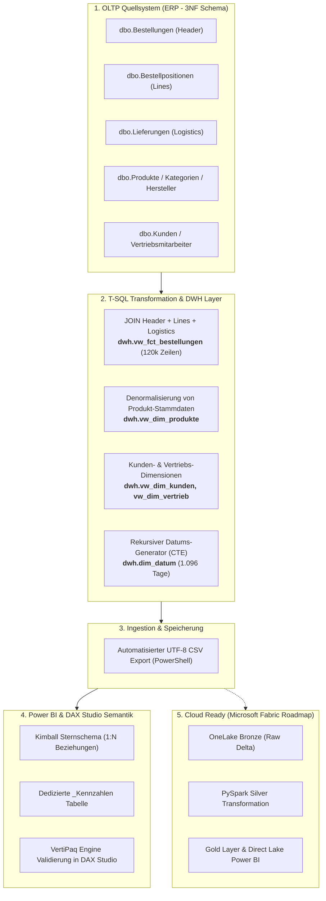

# 🏢 NexusTech B2B Solutions GmbH — Enterprise Data Engineering & BI Analytics Platform

[](https://www.microsoft.com/sql-server)
[](https://powerbi.microsoft.com/)
[](https://daxstudio.org/)
[]()
[]()

Ein realistisches End-to-End Enterprise Data Pipeline & Business Intelligence Projekt auf Basis eines deutschen B2B IT-Distributors und Systemhauses in der DACH-Region (Deutschland, Österreich, Schweiz).

---

## 📊 Executive Dashboard Preview

* **Gesamtumsatz (Realisiert):** **363,82 Mio. €** (bereinigt um Stornierungen & Retouren)
* **Deckungsbeitrag (Rohertrag):** **123,60 Mio. €**
* **Bruttomarge:** **33,97 %**
* **Auftragsvolumen:** **40.000 B2B-Aufträge** (120.000 Positionen)
* **Durchschnittlicher B2B-Bestellwert (AOV):** **~9.100 €**
* **Kundenstamm:** 2.500 Geschäftskunden in DE, AT, CH
* **Produktkatalog:** 120 Enterprise-IT-Produkte in 6 Warengruppen

---

## 🏗️ End-to-End Pipeline Architektur



---

## 🧠 Kernkompetenzen & Data Engineering Best Practices

### 1. Trennung von Transaktion (OLTP) und Analyse (OLAP / DWH)
* In der operativen ERP-Datenbank sind Aufträge in **Kopfdaten** (`Bestellungen`) und **Positionsdaten** (`Bestellpositionen`) getrennt, um Redundanzen zu vermeiden (3. Normalform).
* Für das DWH wurden beide Tabellen mit der Logistik (`Lieferungen`) und den Einkaufspreisen (`Produkte`) verheiratet. Das **Grain (Körnigkeit)** des Fakts ist exakt **1 verkaufte Auftragsposition**.

### 2. Business-Logik & Kennzahlen-Reconciliation
* **Berechnung auf Fact-Ebene:**
  $$\text{Nettoumsatz} = (\text{Menge} \times \text{Einzelpreis}) - \text{RabattBetrag}$$
  $$\text{Gesamtkosten} = \text{Menge} \times \text{Einkaufspreis}$$
  $$\text{Deckungsbeitrag} = \text{Nettoumsatz} - \text{Gesamtkosten}$$
* **Präzision:** Verwendung von `CAST(... AS DECIMAL(18,2))` zur Vermeidung von Gleitkomma-Rundungsfehlern (Floating-Point Drift).
* **Status-Falle & Flagging:**
  Stornierte Aufträge (`Storniert`) und Retouren (`Retoure`) wurden **nicht gelöscht**, sondern über ein Flag `IstUmsatzrelevant` (1/0) gesteuert.
  > 💡 **Ergebnis:** Ohne Bereinigung betrug der Bruttoumsatz **390,28 Mio. €**. Das Flag filterte exakt **26,46 Mio. €** an Stornos und Retouren heraus und lieferte dem Management die reale Zahl von **363,82 Mio. €**.

### 3. Sternschema (Kimball Star Schema)
Das Modell in Power BI besteht aus:
* **`fct_bestellungen`** (Zentrum, 120.000 Zeilen)
* **`dim_datum`** (1.096 Tage, 2023–2025, ISO-Kalenderwochen, Quartale)
* **`dim_produkte`** (120 Produkte, denormalisiert mit Kategorie und Hersteller)
* **`dim_kunden`** (2.500 B2B-Kunden mit Branche, Bonität, Zahlungsziel)
* **`dim_vertrieb`** (12 Vertriebsmitarbeiter mit Zielumsatz und Region)

---

## 📐 Wichtigste DAX-Measures

```dax
-- 1. Realisierter Nettoumsatz
Umsatz = 
CALCULATE(
    SUM(fct_bestellungen[Nettoumsatz]),
    fct_bestellungen[IstUmsatzrelevant] = 1
)

-- 2. Deckungsbeitrag (Rohertrag)
Deckungsbeitrag = 
CALCULATE(
    SUM(fct_bestellungen[Deckungsbeitrag]),
    fct_bestellungen[IstUmsatzrelevant] = 1
)

-- 3. Marge in Prozent
Marge % = 
DIVIDE([Deckungsbeitrag], [Umsatz], 0)

-- 4. Bereinigte Auftragsanzahl
Bestellungen = 
DISTINCTCOUNT(fct_bestellungen[BestellID])

-- 5. Durchschnittlicher Auftragswert (Average Order Value)
Durchschnittlicher Bestellwert = 
DIVIDE([Umsatz], [Bestellungen], 0)
```

---

## 📁 Projektstruktur

```
NexusTech_B2B_ERP_Project/
├── 00_SETUP/
│   └── 01_NexusTech_ERP_erstellen.sql       # DDL & DML für die vollständige ERP-Datenbank
├── 01_DWH_TRANSFORMATION/
│   └── 01_Wie_man_Fakten_und_Dimensionen_baut.sql # DWH Schema & View Definitionen
├── 02_CSV_EXPORTS/
│   ├── export_views_to_csv.ps1              # Robuster .NET/PowerShell UTF-8 CSV Export
│   ├── fct_bestellungen.csv
│   ├── dim_produkte.csv
│   ├── dim_kunden.csv
│   ├── dim_vertrieb.csv
│   └── dim_datum.csv
├── NexusTech_B2B_Analytics.pbix             # Power BI Desktop Modell & Dashboard
└── README.md                                # Projektdokumentation
```

---

## 🚀 Microsoft Fabric Roadmap
Als nächster logischer Entwicklungsschritt wird dieses Setup in **Microsoft Fabric** überführt:
1. **OneLake Ingestion:** Speichern der CSV/Parquet-Dateien im `Bronze`-Lakehouse.
2. **PySpark Data Cleansing:** Transformationen, Typenkonvertierung und Validierung im `Silver`-Layer.
3. **Gold Layer:** Optimierte Delta-Parquet-Tabellen mit Direct Lake Semantic Model für sekundenschnelle Berichte ohne Import-Ladezeiten.
