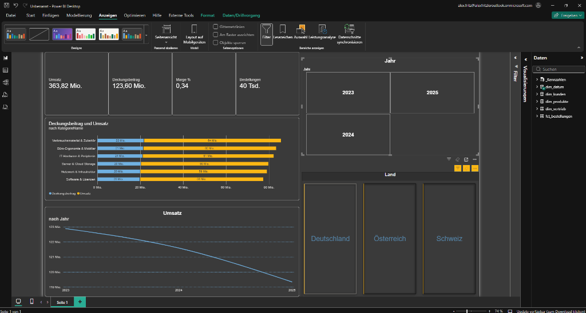
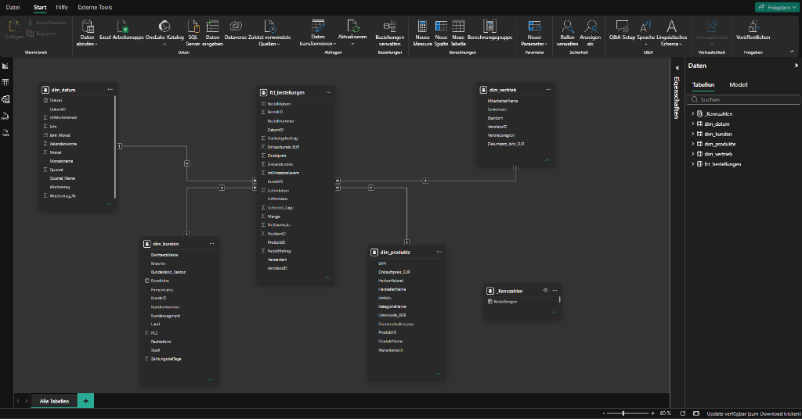
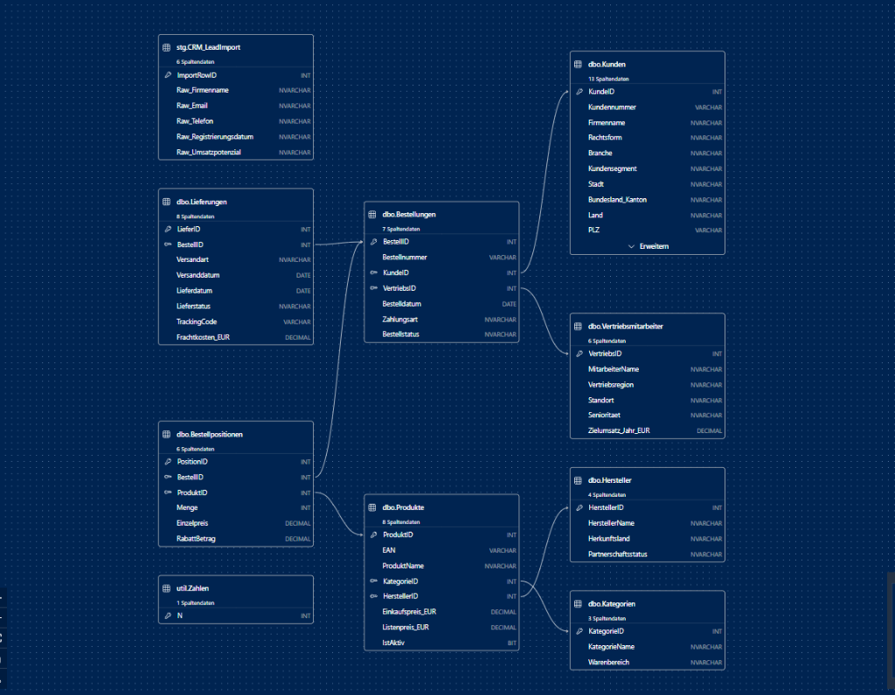
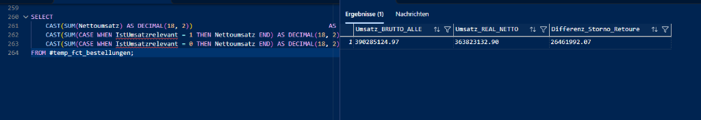
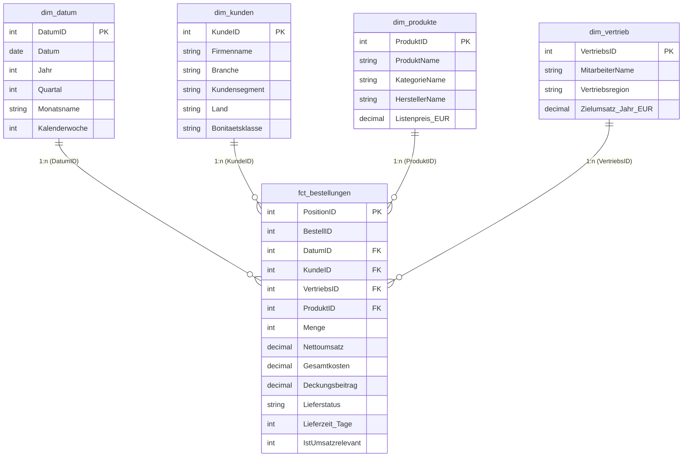
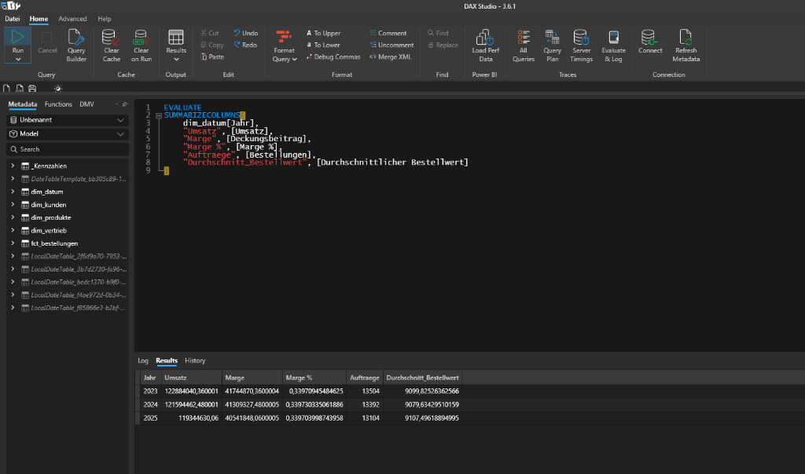
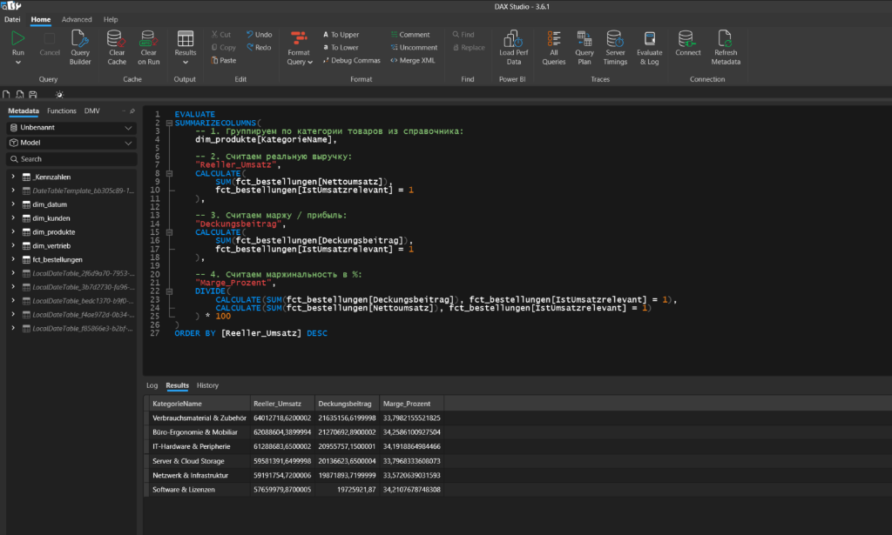

# 🏢 NexusTech B2B Solutions GmbH — ERP-to-Dashboard Data Pipeline
### End-to-End Data Engineering & BI Projekt (SQL Server ➔ DWH ➔ CSV ➔ Power BI ➔ DAX Studio)
### Datengrundlage: `NexusTech_ERP` · DACH-Region · 2.500 B2B-Kunden · 120 Artikel · 120.000 Positionen

[](https://www.microsoft.com/sql-server)
[](https://powerbi.microsoft.com/)
[](https://learn.microsoft.com/dax/)
[](https://daxstudio.org/)
[](#)
[](#)

---

## 📌 Projektübersicht & Unternehmenskontext

**NexusTech B2B Solutions GmbH** (fiktiv) ist ein IT-Distributor und Systemhaus für Geschäftskunden in **Deutschland, Österreich und der Schweiz**. Verkauft werden Server, Netzwerktechnik, IT-Hardware, Software-Lizenzen, Büro-Ergonomie und Verbrauchsmaterial.

Im Unterschied zu einem fertigen Lehrdatensatz startet dieses Projekt bei **rohen, normalisierten ERP-Tabellen (3NF)**. Jeder Schritt bis zum Dashboard wurde manuell in T-SQL aufgebaut und geprüft:

1. **Datenexploration:** ERD lesen, Beleg-Kopf (`Bestellungen`) und Positionen (`Bestellpositionen`) verstehen (1:N).
2. **Sandbox mit `#Temp`-Tabellen:** Faktentabelle zusammenführen, Kennzahlen berechnen, nach jedem JOIN Zeilen abgleichen (Reconciliation).
3. **Statusfalle erkannt:** Stornos, Retouren und offene Lieferungen über ein Flag `IstUmsatzrelevant` getrennt statt gelöscht (**26,46 Mio. €** Unterschied).
4. **DWH-Schicht:** 4 Views + Kalendertabelle im Schema `dwh`.
5. **CSV-Export:** Automatisiert per PowerShell / .NET (UTF-8).
6. **Power BI & DAX Studio:** Sternschema, Kennzahlentabelle, Validierung der Measures 1:1 gegen SQL.

---

## 🖥️ Dashboard-Vorschau & Semantisches Datenmodell

### 1. Executive Dashboard (Power BI Desktop)


### 2. Sternschema in Power BI (1 Fakt, 4 Dimensionen, 1:n)


### 3. Ausgangslage: ERP-Quellsystem in 3. Normalform (SQL Server ERD)


---

## 💡 Zentrale Business Insights

Datenbestand 01/2023 – 12/2025 · 40.000 Aufträge · 120.000 Positionen:

```
┌────────────────────────────┬──────────────────┬──────────────────┬──────────┐
│ Warengruppe                │ Umsatz (real.)   │ Deckungsbeitrag  │ Marge    │
├────────────────────────────┼──────────────────┼──────────────────┼──────────┤
│ Verbrauchsmaterial&Zubehör │  64.012.718,62 € │  21.635.156,62 € │ 33,8 %   │
│ Büro-Ergonomie & Mobiliar  │  62.088.604,39 € │  21.270.692,89 € │ 34,3 %   │
│ IT-Hardware & Peripherie   │  61.288.683,65 € │  20.955.757,15 € │ 34,2 %   │
│ Server & Cloud Storage     │  59.581.391,65 € │  20.136.623,65 € │ 33,8 %   │
│ Netzwerk & Infrastruktur   │  59.191.754,72 € │  19.871.893,72 € │ 33,6 %   │
│ Software & Lizenzen        │  57.659.979,87 € │  19.725.921,87 € │ 34,2 %   │
├────────────────────────────┼──────────────────┼──────────────────┼──────────┤
│ GESAMT                     │ 363.823.132,90 € │ 123.596.045,90 € │ 34,0 %   │
└────────────────────────────┴──────────────────┴──────────────────┴──────────┘
```

### 1. Die Statusfalle: 26,46 Mio. € wären falsch berichtet worden
* **Befund:** Die einfache Summe über alle Positionen ergibt **390,29 Mio. €**. Davon sind nur **363,82 Mio. €** tatsächlich zugestellt. **26,46 Mio. € (6,8 %)** entfallen auf Stornos, Retouren und noch laufende Zustellungen.

  | Lieferstatus | Positionen | Aufträge |
  | :--- | ---: | ---: |
  | Zugestellt | 111.201 | 37.067 |
  | Retoure | 3.999 | 1.333 |
  | In Zustellung | 2.400 | 800 |
  | Storniert | 2.400 | 800 |

* **Umsetzung:** Keine Zeilen gelöscht. Flag `IstUmsatzrelevant` (1/0) in der Faktentabelle, alle Umsatz-Measures filtern darauf. Retourenanalysen bleiben möglich.



### 2. Leicht rückläufige Umsatzentwicklung
* **Befund:** Der realisierte Umsatz sinkt von **122,88 Mio. €** (2023) auf **121,59 Mio. €** (2024, −1,1 %) und **119,34 Mio. €** (2025, −1,8 %). Treiber ist die Auftragsanzahl (13.504 ➔ 13.392 ➔ 13.104), der Bestellwert bleibt stabil bei ca. 9.100 €.
* **Empfehlung:** Analyse der Kundenabwanderung nach Segment und Land (Neukunden vs. Bestandskunden).

### 3. Homogene Margenstruktur
* **Befund:** Alle 6 Warengruppen liegen zwischen 33,6 % und 34,3 % Marge. Es gibt keinen „Margenkiller“, aber auch keinen Hebel über Sortimentsmix.
* **Empfehlung:** Margensteigerung eher über Rabattsteuerung (`RabattBetrag`) und Konditionen mit Herstellern.

---

## 🏗️ Pipeline-Architektur

```mermaid
flowchart LR
    subgraph S1["1 · ERP (dbo, 3NF)"]
        O1["Bestellungen"]
        O2["Bestellpositionen"]
        O3["Lieferungen"]
        O4["Produkte · Kategorien · Hersteller"]
        O5["Kunden · Vertriebsmitarbeiter"]
    end
    subgraph S2["2 · Sandbox (#Temp)"]
        T1["JOIN + Kennzahlen"]
        T2["Reconciliation"]
        T3["Flag IstUmsatzrelevant"]
    end
    subgraph S3["3 · DWH (dwh)"]
        D1["vw_fct_bestellungen"]
        D2["vw_dim_produkte · kunden · vertrieb"]
        D3["dim_datum"]
    end
    subgraph S4["4 · Export"]
        C1["5 × CSV (UTF-8)"]
    end
    subgraph S5["5 · Power BI"]
        P1["Sternschema"]
        P2["_Kennzahlen + DAX Studio"]
        P3["Dashboard"]
    end
    S1 --> S2 --> S3 --> S4 --> S5
```



---

## ⭐ Sternschema-Datenmodell



---

## ⚡ Validierung in DAX Studio

Alle Measures wurden vor dem Dashboard-Bau gegen die SQL-Ergebnisse geprüft. Abweichung: **0,00 €**.





| Kontrolle | SQL Server | DAX Studio |
| :--- | ---: | ---: |
| Umsatz alle Status | 390.285.124,97 | 390.285.124,97 |
| Umsatz realisiert | 363.823.132,90 | 363.823.132,90 |
| Positionen | 120.000 | 120.000 |
| Aufträge | 40.000 | 40.000 |

Abfragen: [`02_dax_studio_validierung.dax`](03_DAX_Measures_Library/02_dax_studio_validierung.dax)

---

## 📐 Kern-Measures (Auszug)

```dax
Umsatz =
CALCULATE(
    SUM(fct_bestellungen[Nettoumsatz]),
    fct_bestellungen[IstUmsatzrelevant] = 1
)

Deckungsbeitrag =
CALCULATE(
    SUM(fct_bestellungen[Deckungsbeitrag]),
    fct_bestellungen[IstUmsatzrelevant] = 1
)

Marge % = DIVIDE([Deckungsbeitrag], [Umsatz], 0)

Bestellungen = DISTINCTCOUNT(fct_bestellungen[BestellID])

Durchschnittlicher Bestellwert = DIVIDE([Umsatz], [Bestellungen], 0)
```

Vollständige Bibliothek inkl. fachlich bereinigtem Bestellwert: [`01_base_measures.dax`](03_DAX_Measures_Library/01_base_measures.dax)

---

## 📂 Struktur des Repositories

```text
NexusTech-B2B-ERP-DataPlatform/
├── README.md                                 # Projektübersicht, Insights & Architektur
├── .gitattributes                            # GitHub Linguist (DAX / TSQL)
│
├── 00_SETUP/
│   └── 01_NexusTech_ERP_erstellen.sql        # Erstellt ERP-Datenbank mit Rohdaten (3NF)
│
├── 01_DWH_TRANSFORMATION/
│   ├── 01_Datenexploration.sql               # SELECT TOP, DISTINCT, erste JOINs, CAST-Übung
│   ├── 02_Sandbox_mit_Temp_Tabellen.sql      # #Temp-Fakt, Reconciliation, Flag, Dimensionen, Kalender
│   └── 03_DWH_Views_erstellen.sql            # Finale Views im Schema dwh + dim_datum
│
├── 02_CSV_EXPORTS/
│   ├── export_views_to_csv.ps1               # .NET/PowerShell Export (UTF-8, Header, Quoting)
│   ├── fct_bestellungen.csv                  # 120.000 Zeilen
│   ├── dim_produkte.csv                      # 120 Zeilen
│   ├── dim_kunden.csv                        # 2.500 Zeilen
│   ├── dim_vertrieb.csv                      # 12 Zeilen
│   └── dim_datum.csv                         # 1.096 Zeilen
│
├── 03_DAX_Measures_Library/
│   ├── 01_base_measures.dax                  # Umsatz, DB, Marge %, Aufträge, Bestellwert, Quoten
│   └── 02_dax_studio_validierung.dax         # EVALUATE-Abfragen mit Sollwerten
│
└── 04_Report_Design_and_Screenshots/
    ├── 01_dashboard_dark_theme.png           # Executive Dashboard
    ├── 02_powerbi_star_schema.png            # Modellansicht Sternschema
    ├── 03_dax_studio_validation.png          # DAX Studio: Jahresübersicht
    ├── 04_sql_server_oltp_erd.png            # ERD des ERP-Quellsystems
    ├── 05_dax_studio_kategorien.png          # DAX Studio: Kategorien
    ├── 06_sql_status_analyse.png             # SQL: Lieferstatus-Analyse
    ├── 07_sql_flag_umsatzeffekt.png          # SQL: 26,46 Mio. € Effekt des Flags
    └── 08_csv_export_powershell.png          # CSV-Export in der Konsole
```

---

## ⚡ Schnellstart: Projekt in 6 Schritten nachbauen

1. **ERP-Datenbank anlegen:** `00_SETUP/01_NexusTech_ERP_erstellen.sql` in SSMS auf `localhost\SQLEXPRESS` ausführen.
2. **Daten erkunden:** `01_DWH_TRANSFORMATION/01_Datenexploration.sql` Block für Block ausführen.
3. **Sandbox durchspielen:** `02_Sandbox_mit_Temp_Tabellen.sql` im selben Abfragefenster ausführen (#Tabellen leben nur dort).
4. **DWH erstellen:** `03_DWH_Views_erstellen.sql` ausführen. Kontrolle: `120000 | 120 | 2500 | 12 | 1096`.
5. **CSV exportieren:**
   ```powershell
   powershell -ExecutionPolicy Bypass -File ".\02_CSV_EXPORTS\export_views_to_csv.ps1"
   ```
6. **Power BI:** *Daten abrufen* ➔ *Text/CSV* ➔ 5 Dateien laden ➔ 1:n-Beziehungen in der Modellansicht prüfen ➔ Tabelle `_Kennzahlen` anlegen ➔ Measures aus `03_DAX_Measures_Library/01_base_measures.dax` einfügen ➔ *Externe Tools* ➔ *DAX Studio* zur Validierung.

---

## 🚀 Nächster Schritt: Microsoft Fabric

1. **Bronze:** CSV-Dateien in ein Lakehouse (OneLake) hochladen.
2. **Silver:** Typisierung, Bereinigung und Flag-Logik in PySpark-Notebooks.
3. **Gold:** Delta-Tabellen im Sternschema + Semantic Model im Direct-Lake-Modus.

---

## 🔗 Offizielle Dokumentation & Referenzen

* 📖 **T-SQL Sprachreferenz (Deutsch):**  
  👉 [https://learn.microsoft.com/de-de/sql/t-sql/language-reference](https://learn.microsoft.com/de-de/sql/t-sql/language-reference)
* 🧩 **Kimball Dimensional Modeling Techniques:**  
  👉 [https://www.kimballgroup.com/data-warehouse-business-intelligence-resources/kimball-techniques/dimensional-modeling-techniques/](https://www.kimballgroup.com/data-warehouse-business-intelligence-resources/kimball-techniques/dimensional-modeling-techniques/)
* 📖 **Microsoft DAX-Sprachreferenz (Deutsch):**  
  👉 [https://learn.microsoft.com/de-de/dax/](https://learn.microsoft.com/de-de/dax/)
* 🧭 **DAX.guide (SQLBI):**  
  👉 [https://dax.guide/](https://dax.guide/)
* ⚡ **DAX Studio Dokumentation:**  
  👉 [https://daxstudio.org/docs/](https://daxstudio.org/docs/)
* 📊 **Power BI: Sternschema-Leitfaden (Deutsch):**  
  👉 [https://learn.microsoft.com/de-de/power-bi/guidance/star-schema](https://learn.microsoft.com/de-de/power-bi/guidance/star-schema)
